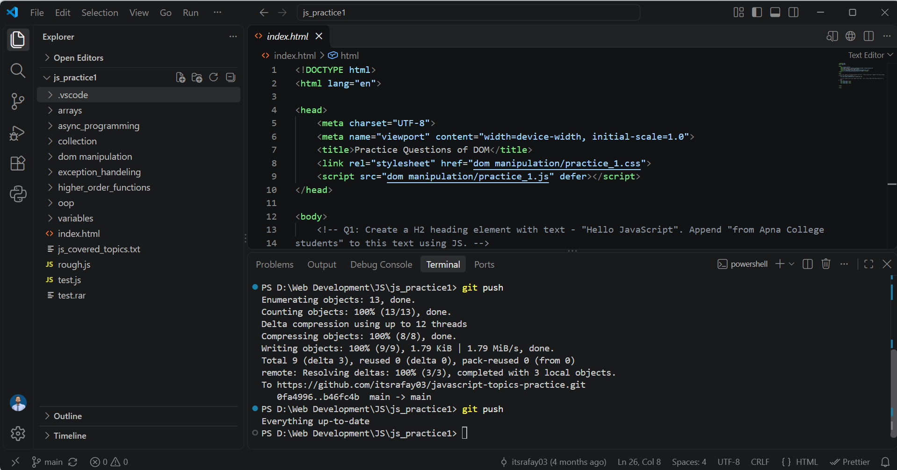

# 🚀 JavaScript Concepts & Practice Hub

[](https://developer.mozilla.org/en-US/docs/Web/JavaScript)
[](LICENSE)

A structured repository containing practical implementations, code snippets, and exercises covering core-to-advanced JavaScript topics. Designed as a comprehensive learning hub and reference guide for modern JavaScript development.

---

## 📸 Workspace Overview

Below is a snapshot of the workspace structure and terminal execution workflow inside **Visual Studio Code**:



---

## 📂 Topic-wise Directory Breakdown

The repository is modularly organized by concept folders, each containing focused scripts and sub-topics:

| Folder                       | Core Focus & Topics Covered                                                                                           |
| :--------------------------- | :-------------------------------------------------------------------------------------------------------------------- |
| 📁 `arrays/`                 | Higher-order array methods (`map`, `filter`, `reduce`), transformations, and array algorithms.                        |
| 📁 `async_programming/`      | Asynchronous flow control, Callbacks, Promises, and `async/await` patterns.                                           |
| 📁 `collection/`             | Keyed collections, `Map`, `Set`, and custom data structures.                                                          |
| 📁 `dom_manipulation/`       | Dynamic element selection, DOM modification, event listeners, and interactive UI behavior.                            |
| 📁 `exception_handeling/`    | Error control structures, `try...catch...finally`, and custom error logging.                                          |
| 📁 `higher_order_functions/` | Closures, function composition, currying, and callback patterns.                                                      |
| 📁 `oop/`                    | Object-Oriented JavaScript, classes, constructor functions, inheritance, and prototypes.                              |
| 📁 `variables/`              | Scope rules (`block`, `function`, `global`), hoisting, data types, and variable declarations (`var`, `let`, `const`). |

---

## 🛠️ Execution & Setup

### Prerequisites

- [Node.js](https://nodejs.org/) (v14+ recommended)
- A modern browser (Chrome, Firefox, Edge, or Safari)
- [Visual Studio Code](https://code.visualstudio.com/) (recommended)

### Local Setup

1. **Clone the repository:**

   ```bash
   git clone https://github.com/itsrafay03/javascript-topics-practice.git
   cd javascript-topics-practice
   ```

2. **Running Node.js Scripts:**
   Navigate into any directory and run scripts via Node.js:

   ```bash
   node async_programming/practice_1.js
   ```

3. **Running DOM Exercises:**
   Open `index.html` in your web browser or use VS Code's **Live Server** extension to observe live DOM manipulation.

---

## 👤 Author

**Abdul Rafay**

- GitHub: [@itsrafay03](https://github.com/itsrafay03)

---

_Created and maintained for continuous JavaScript skill enhancement._
